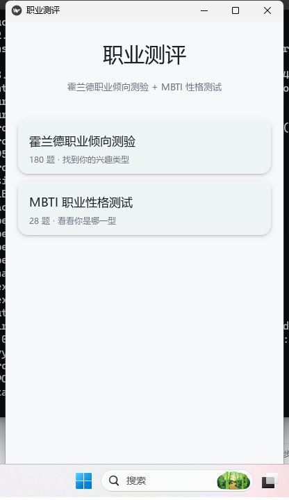
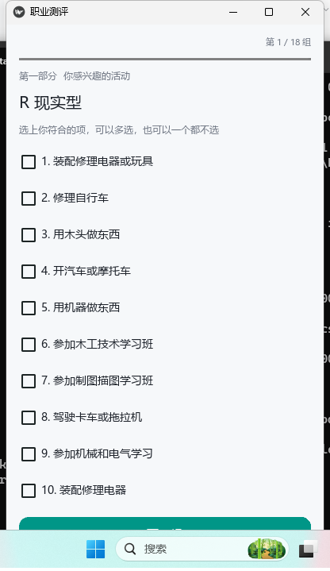
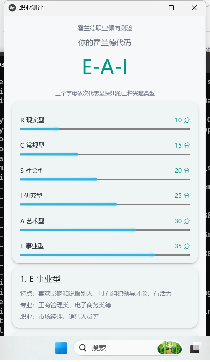
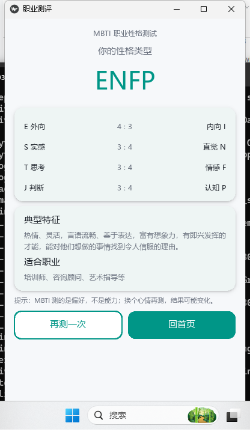

# 职业测评 APP

霍兰德职业倾向测验（教材原版 180 题）+ MBTI 职业性格测试（28 题），
用 Python + Kivy + KivyMD 写成的手机/电脑两用界面。

## 界面预览

| 首页 | 答题页 | 霍兰德结果 | MBTI 结果 |
|---|---|---|---|
|  |  |  |  |

## 目录

| 文件 | 作用 |
|---|---|
| `app.py` | 主程序（界面 + 流程） |
| `data.json` | 题库数据（从霍兰德量表导出） |
| `启动.bat` | 双击运行（调用 py -3.13） |
| `dist/CareerTest.exe` | 打包好的 Windows 程序，双击即用，不用装 Python |
| `console_version.py` | 最早的控制台版，纯文字答题 |
| `mini_result.py` / `mini_screens.py` | 开发时单独预览某个页面，可删 |
| `test_drive.py` / `drive_slow.py` | 开发时自动翻页巡检，可删 |

## 电脑上运行

```
py -3.13 app.py
```

或者直接双击 `dist\CareerTest.exe`（打包版，不用装 Python）。

## 重新打包 exe

```
py -3.13 -m PyInstaller --noconfirm --windowed --onefile ^
    --name CareerTest --add-data "data.json;." app.py
```

生成的 exe 在 `dist\` 下。

## 云端打包 APK（GitHub Actions，不用本机开 WSL）

项目里已经放好 `.github/workflows/build-apk.yml` 和 `buildozer.spec`，
推到 GitHub 后会自动编译安卓包。

1. 注册 GitHub 账号（邮箱即可）
2. 新建一个 **Public** 仓库，不要勾选 “Add a README file”
3. 在 GitHub → Settings → Developer settings → Personal access tokens →
   Tokens (classic) → Generate new token，勾选 `repo`，复制生成的 token
4. 在本机 `E:\career_app` 里执行（把 `<你的用户名>` `<仓库名>` 换掉）：

```
E:\tools\PortableGit\cmd\git.exe remote add origin https://github.com/<你的用户名>/<仓库名>.git
E:\tools\PortableGit\cmd\git.exe push -u origin main
```

用户名填 GitHub 用户名，密码粘贴刚刚的 token（不是登录密码）。

5. 打开仓库的 **Actions** 页，等 “Build Android APK” 跑完（第一次约 30~60 分钟）
6. 进入这次运行，页面底部 **Artifacts** 下载 `careertest-apk.zip`，里面就是 APK
7. 把 APK 发到手机安装（需要允许“安装未知应用”）

注意：这是 debug 签名的测试包，能装能用，但上不了应用商店。

## 安卓安装包（已构建成功，真机验证可用）

`dist/career-test-v3.apk`（37.5 MB，arm64-v8a，debug 签名）
已在一加 Ace 6 / Android 17 上实测：安装、答题流程正常。

- 系统要求：Android 7.0 及以上（minSdk 24），64 位 ARM 手机
- 安装：先卸载旧版，再装新版（debug 签名每次构建都不同，覆盖安装会失败）
- 第一次启动要解压资源，可能等 10~20 秒，属正常
- 这是测试签名，能装能用，但不能上应用商店

已知坑：KivyMD 2.0 的 appbar 会在运行时 import `asynckivy`，
而它依赖 `asyncgui`，打包时必须把两者都写进 buildozer.spec 的 requirements，
否则点进答题页会直接闪退（日志里是 ModuleNotFoundError: asyncgui）。

重新构建：改完代码 `git push`，GitHub Actions 会自动编译，
在仓库 Actions 页的 Artifacts 里下载新的 APK。

## 后续要重新构建 APK

改完代码推送到 GitHub 即可（`main` 分支），云端会自动编译。
本地推送走 SSH（`ssh.github.com:443`），不受 github.com 网页被墙影响：

```
git push origin main
```

## 以后想在本机打 APK（WSL 方式，可选）

Kivy 打包 APK 必须用 Linux 环境（Windows 上 buildozer 不支持）：

1. `wsl --install -d Ubuntu`（需要管理员权限，可能要重启）
2. Ubuntu 里装：`sudo apt install python3-pip openjdk-17-jdk`
3. `pip install buildozer cython`
4. 在项目目录 `buildozer init`，改 `buildozer.spec`：
   - `requirements = python3,kivy,kivymd`
   - `source.include_exts = py,json,png,jpg`
   - 把 `data.json` 一起打包进去
5. `buildozer -v android debug`，APK 在 `bin/` 下

注意：项目要放在 WSL 的家目录（`~/`）里构建，放在 `/mnt/e/` 会非常慢。

## 两个坑（KivyMD 2.0）

1. `MDRaisedButton`、`MDFillRoundFlatButton` 等 1.x 组件已被删除，网上大部分教程是 1.x 写法。
2. 中文字体要手动换：程序里把 `Roboto` 注册成 `msyh.ttc`，否则中文全是方块。
